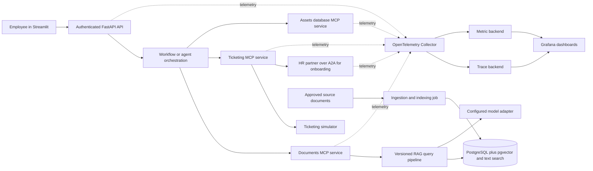

# IT Service Desk Copilot progressive engineering design

**Status:** Proposed implementation design, grounded in the inspected reference project.  
**Date:** 18 November 2026.  
**Working project:** `D:\AI-Engineering\servicedesk-copilot`.  
**Audience:** Experienced engineers building the same application progressively.  
**Scope:** RAG, observability, Git version control, Jenkins CI/CD and container deployment.

Implement the production paths in small, measurable increments while retaining the existing reference behaviour. Start with Git and a reproducible baseline, implement a versioned retrieval index and grounded answering, add operational telemetry, and then use Jenkins to test and promote immutable releases. Do not start by deploying an unmeasured RAG pipeline or replacing every subsystem at once.

This is an implementation plan, not a claim that these capabilities have already been completed. The Jenkins example is not installed as a job. No repository, remote, registry, cloud resource or deployment is created by this document.

## Navigation

- [Current state](#current-state)
- [Target architecture](#target-architecture)
- [RAG design](#rag-design)
- [Observability design](#observability-design)
- [Version control and release identity](#version-control-and-release-identity)
- [Jenkins implementation guide](#jenkins-implementation-guide)
- [Deployment and rollback](#deployment-and-rollback)
- [Progressive implementation sequence](#progressive-implementation-sequence)
- [Decisions and references](#decisions-and-references)

Use [BUILD_TRACKER.md](BUILD_TRACKER.md) to record actual work and evidence after each increment. Its milestones are deliberately more granular than the final release checklist.

## Current state

The source inspection establishes the following baseline. Historic test results are useful starting evidence; rerun them against the commit you actually build.

| Area | Existing implementation | Work still required |
| --- | --- | --- |
| Application | FastAPI, Streamlit, bearer-to-employee mapping, deterministic workflow, direct or MCP transport | Select the measured RAG backend through one application composition layer |
| Ingestion | Markdown/HTML/PDF/DOCX parsing, content hashes, fixed/recursive/parent-child references | Strip HTML portal chrome properly; enrich PDF/DOCX metadata; preserve policy version and visibility contracts |
| Retrieval | Lexical reference; embeddings, semantic chunks, fusion/reranking and pgvector adapter source | Integrate persistent neural retrieval and index lifecycle; benchmark filtering and exact codes |
| Answering | Versioned grounded prompt and citation checking references | Wire a configured provider to grounded generation and evaluate supported claims and abstention |
| Evaluation | 100 draft RAG cases; 40 draft agent cases; 25 attack scenarios; scoring helpers | Review labels, enforce evaluation splits, measure answer metrics and define stable gates |
| Observability | Optional OTLP spans, outbound W3C headers, local bounded latency/error samples | Complete propagation, durable metrics, collector/backends, dashboards, retention and alerts |
| Containers | Non-root teaching image and Compose files | Target-platform dependency lock, model assets, service readiness, secrets, scans and restore/rollback evidence |
| Version control | No Git repository detected at the project root during this inspection | Initialize after review, establish remote/branch policy and version code plus AI artifacts |
| CI/CD | GitHub Actions reference; no root Jenkinsfile in the inspected project | Configure Jenkins agents and jobs, then separate CI from trusted release/deployment |

The saved lexical retrieval report records Recall@5 **0.7667 on draft labels**, not a reviewed heldout benchmark. Other answer-quality metrics are unmeasured. The previous complete reference suite recorded 72 passing tests; later port configuration added focused tests. Do not use a hard-coded test count as an acceptance gate.

Current seed data is synthetic: 5,000 historical tickets, 120 KB articles, 12 policy PDFs, 15 runbooks and a 300-employee/450-device company sample. See [provenance](../DATASET_PROVENANCE.md) and [the dictionary](../DATA_DICTIONARY.md). The snapshot date is 13 November 2026; it is not live company state.

## Target architecture

### Application and data flow



For the initial RAG increment, the same query service can run in-process through a direct adapter. The final service topology uses the documents MCP boundary so direct and MCP paths share the retrieval and authorization implementation. Do not maintain two different retrieval algorithms for the two transports.

### Delivery flow

```mermaid
flowchart LR
  E[Engineer changes a small increment] --> V[Git branch and reviewed commit]
  V --> CI[Jenkins offline CI]
  CI --> IT[Isolated integration and evaluation jobs]
  IT --> IM[Build once and scan container images]
  IM --> REG[Registry stores immutable image digests]
  REG --> ST[Deploy the exact release to staging]
  ST --> SM[Readiness smoke and quality checks]
  SM --> AP[Release approval]
  AP --> DEP[Promote the same artifacts]
  DEP --> MON[Observe or roll back the release tuple]
```



Keep engineering release approval separate from the application's manager/data-owner approval for employee access. Passing one does not satisfy the other.

### Ports and environment boundaries

| Service | Developer host address | Container or server-side address | Exposure |
| --- | --- | --- | --- |
| Existing Jenkins | `http://localhost:8080` | Depends on the existing installation | Leave this port assigned to Jenkins |
| Copilot API | `http://127.0.0.1:8082` | `http://api:8080` inside Compose | Local developer access; TLS ingress in a deployed environment |
| Streamlit | `http://127.0.0.1:8501` | UI process calls `http://api:8080` in Compose | Local developer access; TLS ingress when deployed |
| PostgreSQL | Host 5432 for deliberate local development only | `db:5432` | Private in staging and production |
| Ticketing mock | Host 8081 for local debugging | `ticketing:8081` | Private in deployment |
| Documents/assets/ticketing MCP | Host 8001/8002/8003 only for local debugging | Each service uses port 8000 and `/mcp` | Private authenticated service traffic |
| HR partner | Host 8090 for local debugging | `hr:8090` | Private partner boundary |
| Collector OTLP HTTP | Proposed local port 4318 | `otel-collector:4318` | Private; never publish unauthenticated ingestion on the public internet |
| Grafana | Proposed local port 3000 | `grafana:3000` | Operator access, with authentication |

Inside a container, `localhost` means that container. A Windows Jenkins service account also has its own PATH, permissions and environment; it does not inherit your interactive PowerShell environment. Use configuration appropriate to the process that actually makes the request.

## RAG design

### Contracts and ownership

Introduce a `RagService` interface behind both API/direct and documents-MCP adapters. Its responsibilities are query normalization, authorized retrieval, answer generation and provenance. The orchestration layer continues to own diagnostics, approvals and enterprise actions. A model answer never directly grants a licence or changes a role.

Proposed source structure, retaining existing implementations where they satisfy the contract:

```text
src/copilot/rag/
  pipeline.py          existing Document/Chunk and lexical reference
  advanced.py          existing neural and PostgreSQL references
  service.py           NEW shared RagService and answer contract
  ingestion.py         NEW source registry and metadata enrichment
  index_store.py       NEW persistent generation-aware index lifecycle
  retrieval.py         NEW authorized dense/sparse/fused retrieval
  evaluation.py        NEW split-aware reviewed RAG evaluation
  prompts/grounded-v1.md
src/copilot/api/app.py                 wire the selected service
src/copilot/mcp_servers/servers.py     reuse the same service
src/copilot/config.py                 centralize validated configuration
```

The NEW names are proposed work items, not commands or files already implemented. Refactor gradually; keep old imports or adapters until their callers have migrated and tests pass.

### Source acquisition and ingestion

The current sources are files under `data/kb`, `data/policies`, `data/runbooks` and `data/reference`. There is no live document connector to build in this first increment.

1. Inventory approved source paths and extensions. Join policy files to `data/policies/register.csv`; distinguish current and superseded versions by registry records, not filename guesses.
2. Parse into a normalized document, stripping HTML navigation and preserving table row/column relationships. Record a structured error and quarantine an unreadable source rather than making a partially parsed file current.
3. Attach trusted metadata: source ID/revision, content hash, format, title, system, normalized OS, region, audience, source owner, status and effective date. All runbooks start as IT-only. Do not let model extraction or document body text assign itself a more permissive audience.
4. Validate required metadata and relationships. Missing visibility metadata fails closed. Treat malformed dates, unrecognized audience values and duplicate source revisions as ingestion errors.
5. Compute an ingestion fingerprint from content, trusted metadata, parser version and chunker configuration. A pure file-byte cache misses visibility-only updates and parser fixes.
6. Chunk with a deterministic strategy. Keep numbered steps and tables intact; document oversize atomic units. Store parent/child links where used.
7. Embed under one pinned model revision and normalization scheme, with bounded batching/retry and an idempotent cache. Do not mix dimensions or model spaces in one vector column/index.
8. Load a new candidate index generation; validate its counts, constraints, visibility and representative searches before activating it.

Do not execute ingestion automatically on every `/ask` or at each application replica startup. Run it as a controlled job that is restartable and reports its input/output manifest.

### Storage and index lifecycle

The existing `PostgresIndex` is a reference, not the final schema. Implement migrations and separate source truth from derived search representations.

| Entity | Essential metadata | Purpose |
| --- | --- | --- |
| Document source | `source_id`, source location, owner, trusted audience, source status | Stable identity and withdrawal/visibility control |
| Document revision | `revision_id`, source ID, content/metadata hashes, source version, effective date, parser version | Immutable provenance for a parsed source revision |
| Chunk | `chunk_id`, revision ID, section/parent ID, text hash, chunker version/configuration | Stable citations and reproducible boundaries |
| Search generation | `generation_id`, document/chunk manifest, embedding model/revision/dimension, sparse config, created time, validation status | Identifies one coherent searchable artifact |
| Indexed chunk | generation ID, chunk ID, trusted filter metadata, embedding and text-search vector | Dense and keyword search within a generation |
| Active pointer | environment/collection, generation ID, changed-by/time | Atomic promotion and rollback of the chosen index |

Use deterministic chunk IDs or a uniqueness constraint on generation plus revision plus chunk ordinal. Upserts must not accumulate duplicate old chunks. Reconcile the source inventory so withdrawn sources stop appearing, and retain prior validated generations for a bounded rollback period.

Source visibility/withdrawal is authoritative independently of the chosen generation. A rollback must never reactivate a withdrawn or newly restricted document. Apply the current source registry restrictions at query time and invalidate caches when access metadata changes. Where security corrections make an old index unsafe, rebuild or disable it instead of treating it as a rollback candidate.

For this small corpus, establish an exact vector-search reference first. Add HNSW only after measuring its speed/recall tradeoff on the authorized subsets. Approximate indexing with restrictive filters can return fewer useful candidates; query predicates still belong in the database query, and filtered recall must be measured. See the [pgvector indexing and filtering documentation](https://github.com/pgvector/pgvector).

### Query and answer flow

1. Derive principal/role from verified server identity and authorize the thread before reading conversation state.
2. Resolve OS and region from authenticated profile/device context or an explicit question scope. The caller cannot choose a more privileged audience or an arbitrary employee ID.
3. Rewrite a follow-up from authorized thread history, preserving explicit KB IDs and error codes. Bound history/token usage; do not promote prior user text into system instructions.
4. Search the active generation using the same visibility, effective-date and version constraints in both dense and sparse paths. Apply least-privilege database roles; consider RLS for production defense in depth, with tested identity/session handling and connection-pool reset semantics.
5. Retrieve candidate sets, fuse by reciprocal rank fusion, deduplicate, then rerank authorized candidates. Start with 30 candidates to five contexts as a measured configuration, not a universal optimum.
6. Expand child hits to bounded parent sections where required. Preserve source/chunk identifiers and order complete troubleshooting steps.
7. Use the versioned grounded prompt through the existing model adapter. Sources, tickets and observations remain untrusted data. Bound time, output size and spend; do not log raw source/prompt text by default.
8. Validate response schema and citation membership in the actual evidence passed to generation. Add claim-support checks through reviewed evaluation; citation membership alone does not establish entailment.
9. Return an explicit abstention for insufficient evidence. A model timeout is a service/degraded outcome, not evidence that the KB has no answer. Do not silently switch to an unmeasured backend.

Maintain the existing HTTP `/ask` input (`question`, `thread_id`, `stream`) while evolving the internal result. Proposed answer metadata includes `answer`, `citations`, `abstained`, `answer_mode`, `index_generation`, `prompt_version`, `request_id`, and non-sensitive timing. Keep provider keys, internal storage locations and restricted snippets out of responses. Current SSE returns a completed-result event; introduce true token streaming as a separate change with citation/final-answer validation semantics.

### Configuration and local workflow

Existing fields include model name/key and database URL, but their current presence in settings does not mean all service factories consume them. Centralize configuration loading and inject the selected client/retriever at process startup. Ensure host execution, Jenkins and Compose load the same validated schema through their own environment mechanisms.

The following are **proposed new settings**, not currently supported switches:

```text
COPILOT_RAG_BACKEND=postgres_hybrid
COPILOT_RAG_COLLECTION=it-support
COPILOT_EMBEDDING_MODEL=sentence-transformers/all-MiniLM-L6-v2
COPILOT_EMBEDDING_REVISION=<pinned revision>
COPILOT_RERANK_ENABLED=true
COPILOT_PROMPT_VERSION=grounded-v1
```

Keep the explicit `lexical` reference backend available for offline instruction and comparative testing. Record model/index/prompt identity in each report. Validate vector dimension from the configured model instead of assuming every model emits 384 dimensions.

Existing commands you can run before implementation:

```powershell
Set-Location D:\AI-Engineering\servicedesk-copilot
.\.venv\Scripts\python.exe -m pytest
.\.venv\Scripts\copilot.exe evaluate-retrieval
```

Implement proposed lifecycle commands later, with `--help`, tests and documented inputs, for example `copilot ingest --collection ...`, `copilot index validate --generation ...`, `copilot index activate --generation ...` and split-aware `copilot evaluate-rag`. Do not paste these proposed commands into the current CLI expecting them to exist.

### Evaluation and quality gates

Review the 100-case RAG pool before calling it a golden set. Keep development and heldout membership fixed, audit template-family leakage, normalize OS labels and add relevant passage labels for context precision. Reference answers may need correction because synthetic resolution wording is not guaranteed to answer a vague request uniquely.

| Check | Proposed acceptance evidence |
| --- | --- |
| Ingestion | Re-ingesting unchanged inputs produces no duplicate revisions/chunks; malformed files are quarantined with reasons |
| Metadata | Employees never receive IT-only runbooks, superseded/future policy content or another employee's protected context |
| Updates and withdrawals | Replacing a document removes obsolete active chunks; withdrawal and access restriction remain enforced after rollback |
| Retrieval | Reviewed heldout Recall@5 at least 0.85 as the initial target; report code/OS/region subsets and comparison to the exact-search baseline |
| Answer support | Starting targets: context precision 0.70, faithfulness 0.90, relevance 0.85; record metric definitions, judge/rubric identity and uncertainty |
| Abstention | Reviewed unanswerables return no unsupported instructions; report abstention precision/recall separately |
| Latency and spend | Knowledge-answer p95 at most eight seconds as the starting target under a documented load; cost budget set after provider/prices are chosen |

Thresholds are initial design targets, not measured current results. A report containing nulls, draft labels or a failed required subset does not pass. Run deterministic checks on each commit, a small frozen live smoke suite only in a credentialed trusted job, and broader quality evaluations on a scheduled or release-triggered job. Keep test expectations out of prompts and tool observations.

## Observability design

### Progression and selected stack

Instrument local behaviour while implementing RAG, before container rollout. Start by inspecting structured logs and spans for one request. Then add an OpenTelemetry Collector, a trace store such as Tempo, Prometheus-compatible metrics storage and Grafana. The proposed default is Collector + Tempo + Prometheus + Grafana; choose and pin component versions before creating Compose configurations. A separate log store such as Loki can be added after structured logging and retention are stable.

The existing `/metrics` is authenticated JSON over a process-local deque. It is not Prometheus exposition, durable metrics or a fleet-wide SLO. Preserve it as an instructional diagnostic endpoint until a real metrics export path is implemented.

Collector configuration separates receivers, processors, exporters and service pipelines. Add batch/memory controls and restrict OTLP endpoints to the service network. The official [collector configuration](https://opentelemetry.io/docs/collector/configuration/) describes these roles. Apply source-side minimization and collector-side redaction/drop rules before export; see [handling sensitive data](https://opentelemetry.io/docs/security/handling-sensitive-data/).

### Trace and log contract

Use stable spans for `api.ask`, `agent.run`, `rag.rewrite`, `rag.retrieve.sparse`, `rag.retrieve.dense`, `rag.rerank`, `rag.generate`, `mcp.call`, `ticketing.request`, `a2a.task` and controlled ingestion steps. Propagate W3C trace context through actual HTTP/MCP and A2A clients and server extraction middleware. Test propagation across process boundaries, not just nested in-process calls.

Safe operational attributes include environment, service/version, backend, index generation, prompt version, role category, retrieved-result count, abstention status, operation duration, provider-reported input/output tokens and sanitized error category. Request/trace IDs belong in logs and spans. Never use employee IDs, questions, thread IDs or per-request identifiers as Prometheus labels.

Default logs should contain timestamp, level, stable event name, request ID, trace/span IDs, release identity, operation and outcome. Do not export bearer tokens, authorization headers, raw prompts, document text, user emails or raw exception messages. Keep application audit records separate from general telemetry, with appropriate access and retention. Sanitization must cover errors and instrumentation-added HTTP attributes as well as success logs.

Sampling and retention are explicit environment policy. Development may trace all synthetic requests; deployed defaults should use a measured head-sampling policy, with collector tail-sampling of errors/slow requests if supported and justified. Sampling a trace does not eliminate the need for unsampled metric counts. Define bounded retention and deletion/incident-access ownership before collecting real information.

### Metrics and dashboards

| Metric | Definition | Operator action |
| --- | --- | --- |
| Request latency | Histogram by endpoint/backend/outcome; histogram-derived p50/p95 over a specified window | Locate retrieve/rerank/generate/tool delay in traces |
| Request error rate | Failed requests / all eligible requests, with sanitized error categories | Distinguish provider failures, permission denial and application faults |
| Tool failure/retry rate | Failed tool calls and retries / attempts, split by bounded tool name | Inspect upstream outage and duplicate-effect prevention |
| Retrieval behaviour | Empty-result rate, candidate counts and latency by backend/generation | Check ingestion health, filters and index changes |
| Quality | Periodic/sampled supported-answer and task scores tied to dataset/rubric/release | Reproduce with the same evidence and consider rollback |
| Token use and cost | Provider-reported input/output tokens times versioned input/output prices | Detect budget exhaustion or unexpected model selection |
| Cost per resolved request | Total attributable model cost, including failures/retries, divided by verified resolutions in the same window | Optimize only after success accounting and price identity are reliable |
| Freshness | Active generation/source snapshot and age since successful refresh | Investigate ingestion backlog or failed promotion |

If usage, prices or successful-resolution attribution is unavailable, cost is unknown. Do not report zero or calculate a cost from character counts. Set alert windows, minimum traffic and thresholds after a measured baseline; a single slow request is not an eight-second p95 violation. Proposed first alerts are sustained 5xx/provider failures, ingestion freshness expiry, unavailable active index, excessive tool errors and unauthorized-effect evidence.

Acceptance evidence: a request is traceable from API through retrieval/model and MCP/HR where applicable; telemetry contains no planted identifiers/secrets; metrics survive process replacement in the backend; a deliberate failure appears on the dashboard; and a diagnostic runbook identifies the owning component. Flush exporters on graceful shutdown.

## Version control and release identity

### Establish Git deliberately

The inspected project is not a Git repository. Review its contents before initialization: exclude `.env`, bearer maps, private credentials, `.venv`, `.work`, local databases, traces, model caches and uncurated generated reports. Preserve small reviewed evaluation/baseline artifacts separately from per-run output. The existing `.gitignore` already excludes common secrets/runtime paths, but not every report; inspect the staged diff rather than assuming all files are safe.

Suggested first local steps, to execute when implementing milestone M00:

```powershell
Set-Location D:\AI-Engineering\servicedesk-copilot
git init -b main
git status --short
# Review exclusions and synthetic assets before staging.
git add .gitignore pyproject.toml README.md src tests scripts docs sessions policies release
git diff --cached --stat
# Review .env.example, deployment files and synthetic data before staging those too.
git commit -m "Establish reviewed Copilot reference baseline"
```

This illustrative first commit intentionally stages a reviewed subset. A runnable baseline also needs the approved synthetic `data/`, `services/`, `.env.example`, Docker/Compose files, hooks and CI configuration; review and add those before declaring a clean-clone gate passed. Configure author identity if Git requests it. Choose the remote provider/repository explicitly; add a real remote URL only after it exists and access is approved. No push is part of this design delivery.

Use short-lived branches such as `feature/rag-metadata`, `feature/rag-pgvector` and `feature/otel-propagation`. Merge one reviewable increment into protected `main` after its checks and evidence pass. Keep prompt, policy, schema and evaluation changes reviewable like code. Record measured architecture choices in `docs/adr/`.

### Reproducibility beyond source code

Choose Python 3.12 for the first stable CI/runtime target and generate a reviewed dependency lock for the target platforms. The existing `constraints-tested.txt` records a Windows authoring environment; it is not sufficient proof for a Linux container build. A proposed tooling increment is `uv` plus committed `uv.lock`; use frozen synchronization in CI only after that lock is created and validated. Keep model weights out of normal Git history; store pinned model revisions/artifact hashes in a controlled cache/artifact store.

Every releasable candidate is a tuple:

```text
Git commit and reviewed release tag
+ image digest for every service
+ dependency lock hash and Python/runtime identity
+ prompt and policy hashes
+ corpus/source manifest hash and active index generation
+ embedding/reranker/model provider identities and revisions
+ reviewed evaluation set, rubric and report hashes
+ database migration version and deployment config revision
```

Do not use mutable `latest` images or an unversioned model name as the release identity. Register environment-specific secret references separately; secrets themselves are never part of the manifest. [Git annotated tags](https://git-scm.com/book/en/v2/Git-Basics-Tagging) can mark accepted course milestones and releases, but a tag is not evidence that an unrun gate passed. Suggested milestone tags include `v0.2-rag` and later `v1.0.0` only after the corresponding evidence exists.

## Jenkins implementation guide

### Controller, agents and trust boundaries

Use the existing Jenkins instance on port 8080 as the controller. Do not change its port to accommodate Copilot. First inspect Jenkins version, installed plugins, Java support, agent identity and service-account permissions; this design does not assume the current controller has already been configured for the project.

Start with a dedicated Windows agent labelled `copilot-windows` for the existing offline Python tests. Give it a short workspace path, Git and a known Python installation on its own PATH. Do not run builds inside `D:\AI-Engineering\servicedesk-copilot` or reuse the interactive `.venv`; Jenkins must check out its own commit and create its own environment.

Add a dedicated Linux agent labelled `copilot-linux-docker` for container builds and Compose integration/deployment jobs when Docker capability is available. The previous Windows Docker inspection failed; a Docker CLI existing on PATH does not prove a usable Linux daemon. Verify engine access under the agent account. Use an isolated build agent because access to a Docker daemon is powerful. The official [Windows installation guide](https://www.jenkins.io/doc/book/installing/windows/), [agents guide](https://www.jenkins.io/doc/book/using/using-agents/) and [Docker Pipeline guide](https://www.jenkins.io/doc/book/pipeline/docker/) describe the relevant environment differences.

Required initial capabilities are Pipeline, Git/SCM integration, Credentials Binding, JUnit and the appropriate branch-source integration for your chosen remote. Review compatible versions on the installed Jenkins instance. The optional Docker Pipeline plugin is useful if using its DSL; it is not required merely to run an authorized Docker CLI on an agent.

### First offline CI job step by step

1. Finish the reviewed Git baseline and create the chosen remote. Check that a fresh clone contains the synthetic corpus and all source/tests, not local state or tokens.
2. Register the Windows build agent with the label above. Verify `git --version` and `python --version` from a job under the agent account. Install Python independently if Jenkins cannot see your interactive installation.
3. Review [the seed Jenkinsfile example](examples/Jenkinsfile.windows.ci). Copy it to the repository root as `Jenkinsfile` on an implementation branch; this document does not install it there automatically.
4. Add a Jenkins SCM credential only if the repository requires it. Use its credential ID in the job's SCM configuration. Do not place a PAT/password in a remote URL, Jenkinsfile or job parameter.
5. Create a Multibranch Pipeline with the relevant SCM branch source, repository URL and credential ID. Set the script path to root `Jenkinsfile`, scan branches and run the baseline branch. Jenkins discovers branches containing that file; see [Multibranch Pipeline](https://www.jenkins.io/doc/book/pipeline/multibranch/).
6. For a strictly local teaching exercise before a remote exists, a temporary Pipeline job can paste a reviewed script with a deliberate checkout source. That does not demonstrate remote webhooks, clean-clone reproducibility or a real multibranch workflow; use the remote-backed route as the actual gate.
7. Inspect stage results, console errors and JUnit test history. Publish the actual XML file rather than assuming a command succeeded because a green UI element exists. [JUnit reporting](https://www.jenkins.io/doc/pipeline/steps/junit/) consumes pytest's JUnit XML.
8. Change one test intentionally on a branch and confirm the build fails. Restore it and show a passing run. Change a required MCP schema and confirm contract checking rejects unreviewed drift.
9. Enable polling or a provider webhook only after manual runs work. A repository provider cannot call your laptop's `localhost:8080`; use an approved reachable endpoint or polling rather than opening an ad hoc unauthenticated tunnel.
10. Record job URL, build number, exact commit, test report, dependency identity and the observed failure/pass pair in the tracker.

The supplied seed CI example performs checkout, dependency installation, lint/format, course/schema validation and offline tests. It has no model, registry or deployment credentials and does not start host services. It uses current editable pip installation to get the first job working; switch to frozen lock installation as part of the reproducibility gate before treating it as a release builder.

### Quality, integration and release jobs

| Job class | Trigger and trust | Work | Credentials |
| --- | --- | --- | --- |
| Offline branch/PR CI | Branch commits and reviewed PR policy | Lint, unit/API/SDK contracts, data/schema checks | SCM read access only where necessary; no paid-model or deploy secrets |
| Integration CI | Trusted changes/manual run on isolated Docker agent | Ephemeral PostgreSQL/pgvector and service topology, migrations, restart/idempotency/filter checks | Disposable test credentials only |
| Live evaluation | Trusted scheduled/manual run with frozen cases | Provider smoke/full evaluation, reviewed metrics, spend ceilings | Scoped model credential and budget |
| Release build | Trusted protected source revision | Frozen dependencies, build once, SBOM/vulnerability scan, registry push, manifest | Registry push identity; no production data |
| Staging/promotion | Verified candidate plus explicit authorized operator approval | Pull immutable digests, migrate, activate compatible index, smoke, observe, promote/rollback | Environment-scoped deploy access and runtime secret references |

Keep release/deploy credentials out of any job executing untrusted PR code. Jenkins credential masking is a defense against accidental output, not a guarantee against code that can read those credentials. See [using credentials](https://www.jenkins.io/doc/book/using/using-credentials/) and [multibranch SCM credential trust](https://www.jenkins.io/doc/book/security/securing-org-folders-and-multibranch-pipelines/). Prefer trusted release-job definitions and protected refs over only checking a user-controlled branch name inside an untrusted Jenkinsfile.

Proposed credential IDs might be `copilot-scm-read`, `copilot-model-eval`, `copilot-registry-push` and `copilot-staging-deploy`; these are identifiers to create, not existing configured credentials. Bind them only around the stage that requires them. In Groovy, prefer literal/single-quoted command blocks and let the shell read bound environment variables rather than interpolating secrets into Groovy strings. Do not echo those variables or capture them in archived files. Follow [Jenkinsfile usage](https://www.jenkins.io/doc/book/pipeline/jenkinsfile/) and [Pipeline syntax](https://www.jenkins.io/doc/book/pipeline/syntax/).

Docker integration builds need a unique Compose project and disposable volumes per build. Avoid fixed published ports on CI by running tests on the private Compose network. Cleanup must target that build's exact project, never the learner's or staging environment. Do not place a general `docker compose down -v` against the production project in a `post` block.

### Common Jenkins failures to diagnose

- **Waiting for an executor:** the requested agent label is not online or the node lacks capacity.
- **Python/Git not found:** the service account's PATH differs from your terminal; verify tools on the agent.
- **Permission denied under D drive:** grant the agent access to its own short workspace, not broad access to personal folders.
- **Docker connection failure:** verify the correct OS/daemon/context and access under the agent account; controller installation is not sufficient.
- **Missing JUnit report:** tests never ran, failed before writing XML, or the archive path differs. An empty report cannot be called a successful test run.
- **Green build after a failed command:** ensure each shell command's nonzero status reaches Jenkins. The seed template uses separate `bat` steps to avoid a later successful batch command hiding an earlier failure.
- **Container cannot reach an API:** use service DNS names inside Compose; host `localhost` and service `localhost` are different endpoints.

## Deployment and rollback

### Initial deployment target

Use a single Linux Docker host for the first staging environment, with Compose, persistent storage and an authenticated TLS ingress. This is a proposed portable target, not a chosen cloud account. Kubernetes is outside this first increment. Docker documents environment-specific Compose overlays in [Compose production deployment](https://docs.docker.com/compose/how-tos/production/).

The current teaching Compose file is a starting topology, not a production configuration: services are built from source, several ports are published, some MCP health checks are disabled, local development keys appear in configuration, and runtime state uses SQLite/shared volumes. Replace those properties deliberately.

Create proposed `compose.staging.yml` and later `compose.production.yml` as reviewed deployment definitions. They must use explicit `image:` digests from a release manifest and should not rebuild on promotion. The deployment job must reject a candidate with missing digests, incompatible schema/index identity or required measurements still null.

Before enabling more than one API/worker replica, move approvals, idempotency records, grants, audit, conversation/checkpoint and onboarding state to a designed transactional PostgreSQL schema with migrations. The current shared SQLite files are a single-host teaching adapter; mounting them in several containers is not a replication or high-availability strategy. HR partner task durability and ownership need their own migration plan.

### Build and deploy sequence

1. Resolve the exact source revision and target-platform lock; obtain pinned model assets at build/preparation time instead of downloading mutable weights at first request.
2. Build images once, record digests, scan dependencies/images and retain an SBOM. Fix policy-blocking vulnerabilities or record an approved expiring exception; choose the scanner and severities in implementation, not by ignoring tool output.
3. Create an environment-specific manifest binding code/images/config/schema/index/model/prompt/policy/eval evidence. Validate it before starting a rollout.
4. Verify backup/restore capability and compatibility. Prefer expand/contract migrations that allow old and new application versions during rollout. Document any irreversible change before approving it.
5. Deploy the candidate to a separate staging project/host with private service networks, resource limits, trusted secrets and persistent data volumes. Do not reuse CI volumes or credentials.
6. Separate liveness (`/health` may remain lightweight) from a proposed `/ready` check that validates required database connectivity, current schema and active retrieval generation. A process starting is not evidence it can answer correctly.
7. Run authenticated smoke checks: Mac VPN, Windows 809 plus follow-up, source visibility, idempotent ticket flow, both Finance approvals and explicit-date onboarding. Verify traces and post-action records.
8. Run reviewed quality/load checks on documented hardware and input cases; watch provider limits, embedding/rerank memory and p95 latency.
9. Request release approval with the manifest and evidence. Promotion uses the same candidate digests; it does not run another mutable build.
10. Observe the rollout under defined windows and thresholds. If readiness, privacy, forbidden-effect or required quality checks fail, stop promotion and invoke the reviewed rollback or forward-fix plan.

### Recovery contract

Retain the previous compatible image/config/prompt/policy/index-generation tuple. Restore the active pointer only if current withdrawals/access restrictions remain enforced. Validate schema backward compatibility before switching images. A code rollback does not automatically undo a database migration, a granted licence or a completed HR task.

Keep encrypted database and relevant artifact backups under a documented schedule and retention policy; test restoration into an isolated environment. Set initial RPO/RTO only after the owner chooses the tolerance and a restore rehearsal measures the achievable result. Do not invent recovery guarantees from a backup command existing.

For a bad retrieval generation, revert the active generation/config and verify scope/citations. For a bad application image, promote the previous compatible digest and smoke-test it. For a privacy incident, disable the affected access/export path and follow incident policy; replaying an older permissive policy is not recovery. For irreversible state effects, reconcile with audited compensating business actions.

## Progressive implementation sequence

Each milestone should be a small branch/PR or a short sequence of reviewed PRs. Update the tracker with commit/build/report links before proceeding. Session numbers identify related teaching material; milestones express the actual dependency order.

| Milestone | Related sessions | Build increment | Gate before proceeding |
| --- | --- | --- | --- |
| M00 | 1, 4, 38 | Reviewed Git baseline, clean clone, target Python and dependency-lock plan | Fresh environment runs tests; no secrets/runtime state staged; exact commit recorded |
| M01 | 5–8, 11 | Source registry, ingestion metadata and stable chunks | Same input is idempotent; tables/steps retained; missing audience denied; policy versions correct |
| M02 | 9–10 | Persistent vectors, candidate generations and atomic activation | Exact-search baseline, replacement/withdrawal tests and compatible generation rollback |
| M03 | 11–13 | Authorized sparse/dense/fused retrieval and follow-up/rerank | Role/OS/region/version checks pass; 809/KB-ID/follow-up subsets measured |
| M04 | 14, 16 | Shared RagService, configured grounded generation and API/MCP wiring | Supported citations/abstention/error semantics pass; explicit backend and release identity returned |
| M05 | 15, 35–37 | Reviewed split-aware RAG/agent evaluations and calibrated scoring | Required metrics have provenance and pass selected targets; deliberate bad answer/retriever rejected |
| M06 | 39 | Complete telemetry propagation, collector, persistent metrics and dashboards | One cross-service trace; seeded fault visible; no planted PII/secrets exported |
| M07 | 4, 34, 38 | Jenkins branch CI, schema contracts and trusted quality/integration jobs | Clean checkout succeeds; deliberate test/schema regression fails; reports archived for exact commit |
| M08 | 31, 38, 40 | Reproducible images, scans, staged configuration and readiness | Candidate images run in isolated staging with private services; six-flow checks and load evidence pass |
| M09 | 38–40 | Immutable promotion, rollback and restore rehearsal | Same digests promoted; rollback/restore tested; compatible release tuple and runbooks recorded |

Add minimal spans while implementing M01–M04; do not postpone all instrumentation until M06. The full persistent telemetry stack can wait until the service contracts stabilize. Similarly, create the seed offline Jenkins job once M00 is reproducible; expand it with the M05/M06/M08 gates as those components exist.

### First practical work session

Start with M00: review `.gitignore` and currently generated reports, initialize Git deliberately, record the passing baseline, create a branch, and write the first ingestion-metadata test before modifying retrieval. Keep the running API/UI usable on 8082/8501. The first RAG change should prove that an employee cannot retrieve an IT-only runbook and that the current password policy wins over its superseded revision.

### Evidence retained after every milestone

Record the problem addressed, changed contracts, exact commit, dataset/configuration identity, commands/Jenkins build, observed results, deliberate failing case, fix, remaining limitation, rollback action and reviewer. Use measured values and distinguish reviewed heldout quality from a local fixture/preflight. Keep a small curated report with the branch/PR and archive larger per-run output through Jenkins with appropriate access/retention.

## Decisions and references

Decisions that remain open: Git remote provider/repository, model provider/revision and learner spend cap, embedding/reranker revisions, index refresh policy, telemetry retention/sampling, Jenkins plugins/agent capacity, registry/deployment host, secret manager, quality-gate calibration and recovery tolerances. The portable defaults above let implementation progress without pretending those external choices have been made.

Official references checked on 18 November 2026:

- [pgvector indexing and filtering](https://github.com/pgvector/pgvector)
- [OpenTelemetry Collector configuration](https://opentelemetry.io/docs/collector/configuration/)
- [OpenTelemetry sensitive-data handling](https://opentelemetry.io/docs/security/handling-sensitive-data/)
- [Git annotated tags](https://git-scm.com/book/en/v2/Git-Basics-Tagging)
- [Jenkins Pipeline syntax](https://www.jenkins.io/doc/book/pipeline/syntax/)
- [Jenkinsfile usage](https://www.jenkins.io/doc/book/pipeline/jenkinsfile/)
- [Jenkins Multibranch Pipeline](https://www.jenkins.io/doc/book/pipeline/multibranch/)
- [Jenkins credentials](https://www.jenkins.io/doc/book/using/using-credentials/)
- [Jenkins multibranch credential trust](https://www.jenkins.io/doc/book/security/securing-org-folders-and-multibranch-pipelines/)
- [Jenkins JUnit reporting](https://www.jenkins.io/doc/pipeline/steps/junit/)
- [Jenkins Docker Pipeline](https://www.jenkins.io/doc/book/pipeline/docker/)
- [Docker Compose production deployment](https://docs.docker.com/compose/how-tos/production/)

Recheck installed versions and release notes before implementing examples that depend on plugin, collector or SDK behaviour. This design does not assume a particular Jenkins build or cloud service is already available.
